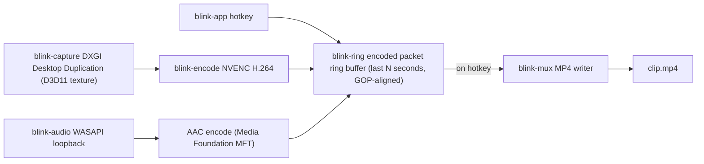

# Architecture

This document records the design of blink: the pipeline, the crate layout, the
rules that govern each crate's `unsafe` usage, and the decisions already made
before any capture, encode, or mux code was written. It exists so that
implementers, human or agent, follow one design instead of re-litigating it per
pull request.

blink is pre-alpha. Everything here describes intent; most of it is not
implemented yet.

Items that cannot be settled without a GPU and a Windows host are marked **needs
hardware verification**; a few others are marked **to confirm before
implementation** where the open question is a license or tooling check rather
than a hardware one. Do not treat those as decided: test them, record the result,
and update this document in the same change.

## Pipeline overview

Two properties define the design:

1. Frames never leave the GPU. The duplicated D3D11 texture is handed to NVENC
   directly, and NVENC returns encoded packets.
2. Only encoded packets are buffered. The ring holds compressed H.264 and AAC,
   not raw frames, so a multi-minute buffer costs megabytes rather than
   gigabytes.

Saving a clip does not touch capture or the encoder. It cuts the ring at an IDR
keyframe, drops the packets before it, and remuxes what remains into MP4.

## Crate layout and unsafe policy

| Crate | Role | `unsafe` policy |
| --- | --- | --- |
| `crates/blink-app` | Binary. Hotkey registration, configuration, wiring, `tracing` setup. | `#![forbid(unsafe_code)]` |
| `crates/blink-ring` | Platform-agnostic encoded-packet ring buffer, GOP-aligned eviction. | `#![forbid(unsafe_code)]`, tests run under Miri |
| `crates/blink-mux` | Platform-agnostic MP4 muxing, including the `pasp` box for stretch. | `#![forbid(unsafe_code)]` |
| `crates/blink-capture` | DXGI Desktop Duplication and D3D11 device management. | `unsafe` allowed; every block needs `// SAFETY:` |
| `crates/blink-audio` | WASAPI loopback capture and AAC encode through a Media Foundation MFT. | `unsafe` allowed; every block needs `// SAFETY:` |
| `crates/blink-encode` | NVENC session management, resource registration, encode calls. | `unsafe` allowed; every block needs `// SAFETY:` |

The three FFI crates are the only place `unsafe` is permitted. They are also
where bugs are most expensive, so they carry the strictest review bar.

Rules that apply everywhere:

- `unsafe` operations are documented with a `// SAFETY:` comment stating why the
  operation is sound. Clippy's `undocumented_unsafe_blocks` and
  `missing_safety_doc` are denied.
- One unsafe operation per block (`multiple_unsafe_ops_per_block` is denied).
  Split the block and explain each operation rather than batching them.
- `unsafe_op_in_unsafe_fn` is denied, so an `unsafe fn` body still needs explicit
  `unsafe` blocks.
- `blink-ring` and `blink-mux` deny indexing and slicing crate-wide. Both process
  untrusted or partially trusted buffers, and an out-of-bounds index would panic
  the recorder mid-session.

## Cross-platform buildability

Windows is the only supported runtime, but it should not be the only place the
workspace compiles.

- The FFI crates declare Windows dependencies under
  `[target.'cfg(windows)'.dependencies]` and gate their modules with
  `#[cfg(windows)]`. On other hosts they compile to a stub.
- `cargo check`, `cargo test`, and `cargo clippy` therefore work for the whole
  workspace on macOS and Linux.
- Windows code is typechecked from other hosts with
  `cargo xwin clippy --target x86_64-pc-windows-msvc`. That never links or runs,
  and can fail on C build scripts that need libclang, so it is best effort
  locally. `windows-latest` CI is authoritative.

The stub is a compile-time convenience, not a fallback. A stubbed build must
report that capture is unavailable rather than silently doing nothing.

## Architecture decisions

### Clock

One timeline, based on the Windows Query Performance Counter. Video frames and
WASAPI packets both carry presentation timestamps in that clock, and the ring
stores the PTS with every packet. Nothing downstream computes time from a
different source, and no component re-derives timestamps from arrival order.

### Variable frame rate

DXGI Desktop Duplication only returns a frame when the screen content changes,
so the duplicated frame rate is inherently variable. There are two ways to
produce a conformant MP4, and the implementation spike picks one:

- Repeat the last frame on the CPU or GPU to hold a constant frame rate, which
  costs work per held frame; or
- Write a variable-frame-rate MP4 with correct per-frame timestamps, which costs
  nothing at capture time but needs muxer support and correct handling in
  players.

Preference is the variable-frame-rate track, because it aligns with the
no-extra-work goal. **Needs verification**: confirm, with hardware and the
players people actually use (editors and share targets included), that the
timestamps are handled correctly. This is the one decision the implementation
spike must settle before the ring's packet format is fixed.

### Audio gaps

WASAPI loopback delivers nothing while the system is silent. blink fills those
gaps with digital silence derived from the QPC timeline rather than waiting for
real samples, so audio and video stay in sync across silence and across a
stream that stalls.

### GOP structure

A fixed IDR interval of 1 to 2 seconds with SPS/PPS repeated on every IDR. That
buys two things the rest of the system depends on:

- The ring evicts whole GOPs, so no packet in the buffer references a frame that
  has already been dropped.
- A clip starts at the nearest IDR at or before `now - N`. The consequence is
  that clips can run up to one GOP longer than the requested duration; this is
  expected, not a bug.

### Codecs

H.264 first, for compatibility with players, editors, and share targets. HEVC is
a later addition, not a v1 requirement. Audio is AAC encoded through the Media
Foundation MFT that ships with Windows, so there is no additional licensing
burden and no bundled encoder binary.

### NVENC loading

`nvEncodeAPI64.dll` is loaded from the installed NVIDIA driver at runtime with
`LoadLibrary`. Nothing NVIDIA-authored is redistributed, which keeps the
licensing story clean and means blink runs against whichever driver version the
user has.

Only permissively licensed headers may be used, and SDK sample code must never
be vendored. **To confirm before implementation** (a license check, not a
hardware one): whether the `nv-codec-headers`-style headers are usable under
their own license, as opposed to the full SDK EULA.

### Why this capture path

Desktop Duplication plus NVENC is NVIDIA's recommended capture path on Windows.
The alternatives were considered and rejected:

- **NvFBC** is deprecated and restricted on GeForce cards.
- **Game hooks** carry anti-cheat risk for little measurable gain, and would put
  blink inside the process it is trying to leave undisturbed.
- **Windows.Graphics.Capture** has no performance advantage over Desktop
  Duplication for this workload.

### HDR

Out of scope for v1. Supporting it later means capturing with
`IDXGIOutput5::DuplicateOutput1` using an FP16 format and then tone-mapping to
SDR or encoding HDR end to end. The pipeline's single-clock and packet-ring
designs do not prevent this, but the muxer and player compatibility story does
need work.

## Performance rules

The primary goal is minimal in-game FPS loss. These rules outrank feature work,
code elegance, and convenience. Every one of them is a review criterion.

1. **Zero-copy.** Register the duplicated D3D11 texture directly with NVENC
   (`NvEncRegisterResource`) and feed it BGRA, so NVENC performs the color
   conversion. No CPU readback, and no color-conversion shader of our own.
2. **No CUDA-core NVENC features.** Use a fast preset (P1 to P3), no lookahead,
   single pass, and no adaptive-quality modes that run on the CUDA cores. Use CBR
   or VBR at a sensible bitrate.
3. **Capture at the clip FPS, not the refresh rate.** On a 240 Hz monitor
   recording at 60 fps, encode every fourth frame.
4. **Skip unchanged frames.** When duplication reports no new content, reuse the
   previous frame's timing without copying or re-encoding.
5. **CPU discipline.** A fixed set of threads, no per-frame allocation
   (preallocated buffers and a preallocated ring), below-normal priority on
   blink's threads, and saving and muxing on a low-priority thread that the
   capture and encode threads never wait on.
6. **Native resolution by default.** No scaling pass. Downscaling is opt-in.
7. **Measure.** Every change that touches the hot path includes before-and-after
   numbers produced with [BENCHMARKING.md](BENCHMARKING.md).

A change that violates any rule needs the rule changed here first, with numbers,
in its own pull request.

## Resolution changes

This is the least obvious part of the design, and CS2 in fullscreen at a
stretched 4:3 resolution exercises all of it: the game launch, the alt-tab, and
the stretch.

### Capture recovery

A game launch or alt-tab changes the display mode, which ends the duplication
session with `DXGI_ERROR_ACCESS_LOST`. Recreate the session with a short retry
backoff, because several of these can arrive in a row as the mode settles. The
recording gap lasts a fraction of a second.

### Encoder reconfiguration

Create the NVENC session once, with its maximum width and height set to the
native resolution, then call `NvEncReconfigureEncoder` with a forced IDR on each
size change. The encoder is never torn down and recreated, so a mode change does
not cost a session setup.

**Needs hardware verification**: that a session created at the native size
accepts smaller reconfigured sizes without renegotiating the `NV_ENC_CAPS` and
buffer-format settings.

### Ring segments

Every resolution change starts a new segment, and a clip only spans the current
segment, because an MP4 whose track changes resolution mid-stream plays badly in
most players. The consequence is that right after an alt-tab a clip can be
shorter than the requested N seconds. Report this to the user rather than
trimming or merging segments.

### Stretched look at zero cost

An optional `stretch_to` config value (for example `1920x1080`) sets the H.264
sample aspect ratio in the VUI and the MP4 `pasp` box, so players display 4:3
frames stretched, exactly as they appear in game. There is no GPU scaling pass
and no extra frame work; the pixels are untouched and only the display aspect
metadata changes. It is off by default.

**Needs hardware verification**: whether Desktop Duplication reports the game's
mode resolution (1280x960, say) rather than a pre-scaled native image under the
different GPU scaling settings (full panel, aspect ratio, no scaling). If the
compositor pre-scales, `stretch_to` has nothing to stretch and the design needs
revisiting.

## Open questions for the implementation phase

- NVENC bindings: an existing crate, or our own `bindgen`-generated
  `blink-nvenc-sys` with pre-generated bindings checked in so builds do not need
  libclang.
- MP4 muxer: an existing crate, or a minimal hand-written writer. The `pasp` box
  and variable-frame-rate support above constrain the choice.
