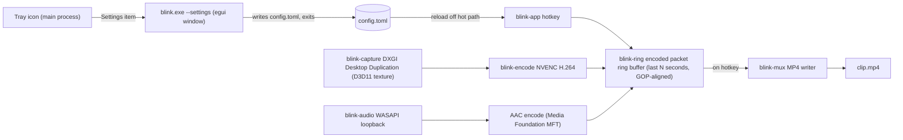

# Architecture

This document records the design of blink: the pipeline, the crate layout, the
rules that govern each crate's `unsafe` usage, and the decisions behind them. It
exists so that implementers, human or agent, follow one design instead of
re-litigating it per pull request.

blink is pre-alpha. The pipeline described here is implemented; what is still
open is marked below.

Items that cannot be settled without a GPU and a Windows host are marked **needs
hardware verification**; a few others are marked **to confirm before
implementation** where the open question is a license or tooling check rather
than a hardware one. Do not treat those as decided: test them, record the result,
and update this document in the same change.

## Pipeline overview

Two properties define the design:

1. Frames never leave the GPU. The duplicated D3D11 texture is handed to NVENC
   directly, and NVENC returns encoded packets.
2. Only encoded packets are buffered. The ring holds compressed H.264 and AAC,
   not raw frames, so a multi-minute buffer costs megabytes rather than
   gigabytes.

Saving a clip does not touch capture or the encoder. It cuts the ring at an IDR
keyframe, drops the packets before it, and remuxes what remains into MP4.

## Crate layout and unsafe policy

| Crate | Role | `unsafe` policy |
| --- | --- | --- |
| `crates/blink-app` | Binary. Hotkey registration, configuration, wiring, `tracing` setup. | `#![forbid(unsafe_code)]` |
| `crates/blink-ring` | Platform-agnostic encoded-packet ring buffer, GOP-aligned eviction. | `#![forbid(unsafe_code)]`, tests run under Miri |
| `crates/blink-mux` | Platform-agnostic MP4 muxing, including the `pasp` box for stretch. | `#![forbid(unsafe_code)]` |
| `crates/blink-config` | Shared config types and load/save, used by both processes. | `#![forbid(unsafe_code)]` |
| `crates/blink-ui` | egui/eframe settings window for the `--settings` process. | `#![forbid(unsafe_code)]` |
| `crates/blink-capture` | DXGI Desktop Duplication and D3D11 device management. | `unsafe` allowed; every block needs `// SAFETY:` |
| `crates/blink-audio` | WASAPI loopback capture and AAC encode through a Media Foundation MFT. | `unsafe` allowed; every block needs `// SAFETY:` |
| `crates/blink-encode` | NVENC session management, resource registration, encode calls. | `unsafe` allowed; every block needs `// SAFETY:` |
| `crates/blink-sys` | Win32 plumbing the other crates share: the QPC clock, thread priority and background mode, the single-instance mutex, the tray thread's message pump, and asynchronous playback of in-memory WAV sounds. Also the portable helpers they share: `Backoff`, `ErrorChain`, and the replacing and no-replace file renames. | `unsafe` allowed; every block needs `// SAFETY:` |

The four FFI crates are the only place `unsafe` is permitted. They are also
where bugs are most expensive, so they carry the strictest review bar.

Rules that apply everywhere:

- `unsafe` operations are documented with a `// SAFETY:` comment stating why the
  operation is sound. Clippy's `undocumented_unsafe_blocks` and
  `missing_safety_doc` are denied.
- One unsafe operation per block (`multiple_unsafe_ops_per_block` is denied).
  Split the block and explain each operation rather than batching them.
- `unsafe_op_in_unsafe_fn` is denied, so an `unsafe fn` body still needs explicit
  `unsafe` blocks.
- `blink-ring` and `blink-mux` deny indexing and slicing crate-wide. Both process
  untrusted or partially trusted buffers, and an out-of-bounds index would panic
  the recorder mid-session.

## Cross-platform buildability

Windows is the only supported runtime, but it should not be the only place the
workspace compiles.

- The FFI crates declare Windows dependencies under
  `[target.'cfg(windows)'.dependencies]` and gate their modules with
  `#[cfg(windows)]`. On other hosts they export only their portable items
  (config, errors, pure logic). The entry points of `blink-capture` and
  `blink-audio` also have stubs that return an `Unsupported` error;
  `blink-encode` and `blink-sys` have none.
- `cargo check`, `cargo test`, and `cargo clippy` therefore work for the whole
  workspace on macOS and Linux.
- Windows code is typechecked from other hosts with
  `cargo xwin clippy --target x86_64-pc-windows-msvc`. That never links or runs,
  and can fail on C build scripts that need libclang, so it is best effort
  locally. `windows-latest` CI is authoritative.

The stubs are a compile-time convenience, not a fallback. A stubbed build must
report that capture is unavailable rather than silently doing nothing.

## Architecture decisions

### Clock

One timeline, based on the Windows Query Performance Counter. Video frames and
WASAPI packets both carry presentation timestamps in that clock, and the ring
stores the PTS with every packet. `blink-sys` owns the conversion from QPC
counts to 100 ns `Timestamp` ticks (`QpcClock`) and the `qpc_now` reading that
capture, audio, and save requests share. Nothing downstream computes time from a
different source, and no component re-derives timestamps from arrival order.

### Variable frame rate

DXGI Desktop Duplication only returns a frame when the screen content changes,
so the duplicated frame rate is inherently variable. blink writes a
variable-frame-rate MP4 rather than repeating frames to hold a constant rate:
each encoded frame keeps its capture timestamp, the ring stores it, and the
muxer writes per-sample durations from consecutive timestamps. Nothing is
encoded while the screen is static except the periodic IDR refresh that keeps
a clip start available. Repeating frames would cost encoder work per held
frame, which the no-extra-work goal rules out.

**Needs verification**: confirm, with hardware and the players people actually
use (editors and share targets included), that the timestamps are handled
correctly.

### Audio gaps

WASAPI loopback delivers nothing while the system is silent. blink fills those
gaps with digital silence derived from the QPC timeline rather than waiting for
real samples, so audio and video stay in sync across silence and across a
stream that stalls.

Fill covers gaps up to 60 seconds (silent AAC frames cost a few bytes each). A
longer gap, usually a system sleep, ends the audio segment instead: the encoder
is drained and the next packet starts a new segment at its real timestamp. A
clip spanning that point has an audio timestamp jump, which the muxer must
handle (with an edit list or by starting the clip's audio after the jump), but
a clip cut from the last few minutes never spans it in practice.

### GOP structure

An IDR at least once per second of PTS, with SPS/PPS repeated on every IDR.
Capture is variable-rate (unchanged frames are skipped), so the interval is
measured in timestamps, not frames: NVENC runs with an infinite GOP and the
encoder forces an IDR once a second of PTS has passed since the last one, on
the first frame after a resize, and whenever the ring asks for one
(`PushOutcome::DroppedAwaitingKeyframe`). On a static screen nothing is
encoded, so the capture loop asks the encoder whether an IDR is due and
re-encodes its last captured texture when it is. That buys two things the rest
of the system depends on:

- The ring evicts whole GOPs, so no packet in the buffer references a frame that
  has already been dropped.
- A clip starts at the nearest IDR at or before `now - N`. The consequence is
  that clips can run up to one GOP longer than the requested duration; this is
  expected, not a bug.

### Codecs

H.264 first, for compatibility with players, editors, and share targets. HEVC is
a later addition, not a v1 requirement. Audio is AAC encoded through the Media
Foundation MFT that ships with Windows, so there is no additional licensing
burden and no bundled encoder binary.

### NVENC loading

`nvEncodeAPI64.dll` is loaded from the installed NVIDIA driver at runtime with
`LoadLibrary`. Nothing NVIDIA-authored is redistributed, which keeps the
licensing story clean and means blink runs against whichever driver version the
user has.

Only permissively licensed headers may be used, and SDK sample code must never
be vendored. **To confirm before implementation** (a license check, not a
hardware one): whether the `nv-codec-headers`-style headers are usable under
their own license, as opposed to the full SDK EULA.

### Why this capture path

Desktop Duplication plus NVENC is NVIDIA's recommended capture path on Windows.
The alternatives were considered and rejected:

- **NvFBC** is deprecated and restricted on GeForce cards.
- **Game hooks** carry anti-cheat risk for little measurable gain, and would put
  blink inside the process it is trying to leave undisturbed.
- **Windows.Graphics.Capture** has no performance advantage over Desktop
  Duplication for this workload.

### HDR

Out of scope for v1. Supporting it later means capturing with
`IDXGIOutput5::DuplicateOutput1` using an FP16 format and then tone-mapping to
SDR or encoding HDR end to end. The pipeline's single-clock and packet-ring
designs do not prevent this, but the muxer and player compatibility story does
need work.

## Performance rules

The primary goal is minimal in-game FPS loss. These rules outrank feature work,
code elegance, and convenience. Every one of them is a review criterion.

1. **GPU-only, one copy.** Each admitted frame costs exactly one GPU
   `CopyResource` from the duplicated surface into a small pool of textures
   that blink owns (`blink-capture`, `TEXTURE_POOL_SIZE` = 3). NVENC registers
   those pool textures (`NvEncRegisterResource`) and is fed BGRA, so NVENC
   performs the color conversion. No CPU readback, no scaling, and no
   color-conversion shader of our own.

   The copy is deliberate. The duplicated surface is a single OS-owned texture
   that DXGI reuses for every frame, so it cannot stay mapped as encoder input
   across an asynchronous encode or the next `AcquireNextFrame`. Its bind flags
   are not guaranteed, and it changes identity with every duplication session,
   which would churn NVENC registrations on each mode change. Holding the
   frame is not the problem: Microsoft recommends releasing it just before the
   next acquire.

   Cost: a copy reads and writes the frame once, so at 2560x1440 BGRA and
   60 fps that is about 14.7 MB x 2 x 60 = 1.8 GB/s of video memory
   bandwidth, a fraction of a percent of a current discrete GPU's. **Needs
   hardware verification**: measure the copy's GPU time (timestamp queries or
   the GPU 3D-engine delta in a capture-on versus capture-off benchmark run)
   at 1440p and 4K, and record it with the other benchmark results.
2. **No CUDA-core NVENC features.** Use a fast preset (P1 to P3), no lookahead,
   single pass, and no adaptive-quality modes that run on the CUDA cores. Use CBR
   or VBR at a sensible bitrate.
3. **Capture at the clip FPS, not the refresh rate.** On a 240 Hz monitor
   recording at 60 fps, encode every fourth frame.
4. **Skip unchanged frames.** When duplication reports no new content, reuse the
   previous frame's timing without copying or re-encoding.
5. **CPU discipline.** A fixed set of threads, no per-frame allocation
   (preallocated buffers and a preallocated ring), below-normal priority on
   blink's threads, and saving and muxing on a low-priority thread that the
   capture and encode threads never wait on.
6. **Native resolution by default.** No scaling pass. Downscaling is opt-in.
7. **Measure.** Every change that touches the hot path includes before-and-after
   numbers produced with [BENCHMARKING.md](BENCHMARKING.md).

A change that violates any rule needs the rule changed here first, with numbers,
in its own pull request.

## Resolution changes

This is the least obvious part of the design, and CS2 in fullscreen at a
stretched 4:3 resolution exercises all of it: the game launch, the alt-tab, and
the stretch.

### Capture recovery

A game launch or alt-tab changes the display mode, which ends the duplication
session with `DXGI_ERROR_ACCESS_LOST`. Recreate the session with a short retry
backoff, because several of these can arrive in a row as the mode settles. The
recording gap lasts a fraction of a second.

Recovery has two tiers. The duplicator recreates a lost session itself, on the
same D3D11 device, so the NVENC session and its texture registrations survive
(a size change goes through encoder reconfiguration below). Only errors that
recreating the session cannot fix, such as device removal, end the capture
session: the capture thread then rebuilds the device, duplicator, and encoder.
Its backoff resets only after a session has encoded for 10 seconds, so a fault
that recurs every few seconds escalates the delay instead of rebuilding at the
shortest one.

A process can hold one duplication per output, and `DuplicateOutput` returns
`E_INVALIDARG` while any reference to the previous session is alive. The
duplicator drops its session before recreating it, including on the idle
resync after a dropped change.

Only frames with new desktop content (`LastPresentTime != 0`) are copied. A
pointer-only update's surface is not guaranteed to hold the desktop, and on
a new session it is black, so copying one encodes a black frame. A new
session therefore waits for its first content update. A change the decimator
dropped is delivered by the next content update, or by a resync once its slot
has gone a whole frame interval without one: at 144 Hz into 60 fps the next
update can land up to 6.9 ms after the slot opens, so resyncing as soon as it
opens would recreate the session on most frames of continuous motion. A new
session with nothing to show (startup, or after a resize) that gets no content
update within a second is re-duplicated, backing off to every 8 s, rather than
copying a pointer-only frame.

### Encoder reconfiguration

Create the NVENC session once, with its maximum width and height set to the
native resolution, then call `NvEncReconfigureEncoder` with a forced IDR on each
size change. The encoder is never torn down and recreated, so a mode change does
not cost a session setup.

**Needs hardware verification**: that a session created at the native size
accepts smaller reconfigured sizes without renegotiating the `NV_ENC_CAPS` and
buffer-format settings.

### Ring segments

Every resolution change starts a new segment, and a clip only spans the current
segment, because an MP4 whose track changes resolution mid-stream plays badly in
most players. The consequence is that right after an alt-tab a clip can be
shorter than the requested N seconds. Report this to the user rather than
trimming or merging segments.

### Stretched look at zero cost

An optional `stretch_to` config value (for example `1920x1080`) is the display
size every frame is shown at. The encoder derives the sample aspect ratio for
the current encode size (`stretch_w * height : stretch_h * width`, so 1280x960
stretched to 1920x1080 is 4:3) and recomputes it on every resize, so the native
desktop after an alt-tab goes back to square pixels. The ratio lands in the
H.264 VUI (NVENC derives it from the display aspect ratio it is given) and the
MP4 `pasp` box, so players display 4:3 frames stretched, exactly as they appear
in game. There is no GPU scaling pass and no extra frame work; the pixels are
untouched and only the display aspect metadata changes. It is off by default.

**Needs hardware verification**: whether Desktop Duplication reports the game's
mode resolution (1280x960, say) rather than a pre-scaled native image under the
different GPU scaling settings (full panel, aspect ratio, no scaling). If the
compositor pre-scales, `stretch_to` has nothing to stretch and the design needs
revisiting.

## Saving a clip

The ring keeps the clip length plus 3 seconds. A save waits 200 ms after the
hotkey press so the encoder and audio packets of that moment land, then copies
while capture keeps pushing; without the slack, those newer packets would evict
the keyframe the clip starts at. Saving runs on two threads, so copying never
waits on the disk. The cutter sizes and page-touches a reusable clip buffer
before taking the ring lock, copies in 1 MB chunks at below-normal priority,
and hands the lock back with a fair unlock between chunks, so a push waits at
most one chunk. The writer writes the MP4 in Windows background mode (lowest
CPU and I/O priority), never holding the lock, to a hidden `.partial` file
that is renamed when complete; leftovers from a crash are deleted at startup.
A second press while a clip is being written is cut right away into a second
buffer, which is freed once both are back; more presses are ignored.

### Save sound

When the writer reports a result, the tray thread plays a short chime: a
rising two-note one (250 ms) when the clip was written, a lower falling pair
(300 ms) when the save failed. The `save_sound` setting, on by default,
turns it off; the tray thread reads it from the current config each time, so
a change applies to the next save.

The sounds are synthesized in code (`blink-app`'s `chime` module, integer
sine and envelope arithmetic) rather than shipped as audio files, so there is
no asset to license and nothing in the binary but the generator. Each is
rendered once at startup into a 16-bit mono 24 kHz WAV image (about 12 KB and
14 KB) that lives until the process exits. `blink_sys::play_wav` hands that
image to winmm's `PlaySoundW` with `SND_MEMORY | SND_ASYNC`: the call returns
once winmm's own thread has the sound, and that thread keeps reading the
image during playback, which is why the wrapper takes a `'static` slice and
checks the RIFF length against it. A save therefore costs no allocation and
no work on the capture, encode, or save threads; a second result while a
sound plays cuts it off. An `IAudioClient` render stream would add a thread
and device handling for no benefit at this length.

The chime plays through the default output device, so WASAPI loopback
records it into the ring, and the next clip covering that moment has it in
its audio. That is accepted, as it is in other clip recorders; turning the
sound off is the remedy.

**Needs hardware verification**: that the first `PlaySoundW` call (which
loads winmm's audio stack) does not stall the tray thread noticeably, and
that the chime's volume sits comfortably under typical game audio.

## Settings UI

The main `blink` process contains only the capture engine and a system tray icon
(the `tray-icon` crate, driven by an idle Win32 message loop). The binary links
eframe/egui, but the engine process never initializes it. The tray's "Settings"
item spawns `blink.exe --settings`, a separate short-lived process that shows a
small fixed-size egui window on eframe's OpenGL (glow) renderer. It repaints
only on input, never continuously. Closing the window exits the process, so the
settings UI and its GL context cost nothing while gaming.

Rationale: an in-process GPU-backed UI keeps a GPU context resident for the life
of the process; a separate process that exits removes that cost entirely, so the
toolkit choice does not affect in-game FPS. egui is MIT/Apache-2.0, and runs
unchanged on macOS and Linux, which blink may support later. glow rather than wgpu keeps the binary and dependency tree small;
blink already requires an NVIDIA GPU, whose drivers always provide OpenGL. Raw
Win32 would be marginally lighter, but needs extensive `unsafe` code and is
Windows-only.

Settings exposed: output folder, clip length (seconds), hotkey, FPS,
quality/bitrate, audio on/off, the optional `stretch_to`, and the save sound
on/off.

IPC: there is none beyond the file and the process exit. The settings process
writes `%APPDATA%\blink\config.toml` atomically (write a temp file, then rename)
and exits. The engine spawned it, so it waits for that child to exit and then
reloads the config off the hot path. Changes to FPS, video or audio bitrate,
audio on/off, or `stretch_to` restart the pipeline cleanly (capture, encoder,
audio, and a fresh ring). The save hotkey is suspended while the window is open and registered again
when it closes, so a new hotkey applies live; a new clip length
swaps in a resized ring live (the buffered clip is lost), and a new output
folder or save sound setting applies to the next save. An invalid file is logged and ignored; the
engine keeps its previous config. Hand edits to the file are picked up the next
time the settings window closes.

`blink-config` holds the shared config types and load/save. `blink-ui` is a
library with one entry point, `blink_ui::run(config_path)`, which `blink-app`
calls when started with `--settings` and which returns whether the user saved
(a Save with no changes does not rewrite the file) or cancelled. The window
opens the file without validating it, so out-of-range values show inline
errors; it validates the draft every frame and disables Save while any error
remains. A config file that does not parse is never overwritten: the settings
window does not open and a native error dialog says why. eframe is built with
only the glow renderer, egui's bundled fonts, and the system clipboard (no
wgpu, accessibility, or Wayland). The crate forbids `unsafe`. The engine never calls into
`blink-ui`, so no UI toolkit initializes in the engine process.

The hotkey recorder picks the key the way the engine's registration will
match it, so the key that records is the key that fires. `global-hotkey`
registers a virtual-key code on Windows and a keysym on X11, both of which
follow the keyboard layout, so the recorder prefers the key's layout meaning
(AZERTY's A key records A) and falls back to its position for keys with no
Latin meaning (a Cyrillic layout records the US position). macOS registers by
position, so there the recorder prefers the position. Numpad digits record as
digits; they fire only if the engine also registers the numpad codes.
Ctrl+C, Ctrl+X, and Ctrl+V (Cmd on macOS) stay copy and paste for the text
fields and cannot be recorded. egui's modifier state has no Windows-key flag
outside macOS, so the recorder tracks the Super key presses egui reports
instead; combinations the shell reserves (Win+L, Win+D) never reach the window.

Every dependency's license and copyright notice, including the fonts egui
embeds, is in `THIRD-PARTY-NOTICES.txt`, generated by cargo-about (`just
notices`) and checked for staleness in CI. Release artifacts ship it next to
`blink.exe`. The size-heavy UI crates are built at `opt-level = "s"` in the
release profile; the engine's crates keep the default speed level.

## Decisions settled during implementation

- NVENC bindings are hand-written declarations in `crates/blink-encode/src/ffi`,
  covering only the API blink calls. Nothing is generated at build time, so no
  libclang is needed; `ffi/README.md` records the header version they follow.
- The MP4 muxer is a minimal hand-written writer in `blink-mux`, which keeps
  the `pasp` box and variable-frame-rate sample durations under our control.
